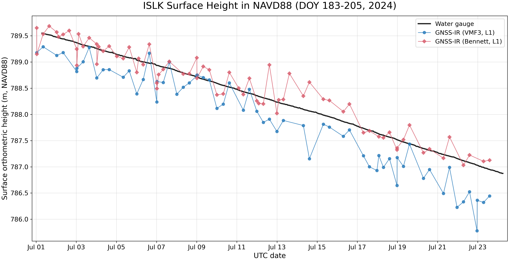

# GNSS-IR Water-Level Validation: VMF3 vs. Bennett

A reproducible GPS L1 GNSS Interferometric Reflectometry (GNSS-IR) workflow for
estimating inland-water surface elevation and comparing two atmospheric
refraction treatments—VMF3 and Bennett—against a co-located water gauge in the
NAVD88 absolute vertical reference frame.

The demonstration case uses station **ISLK**, year **2024**, day of year (DOY)
**183–205**. The workflow is command-line driven: `main.py` documents and
orchestrates the complete processing chain.



## Project objective

This project combines:

1. **Antenna PCO/APC correction** — establishes the antenna phase-center height.
2. **Atmospheric correction comparison** — processes GPS L1 observations using
   VMF3 and Bennett refraction treatments.
3. **Absolute-frame validation** — converts the GNSS-derived water surfaces and
   gauge measurements to NAVD88, then calculates signed and absolute errors.

## Main data flow

```text
local RINEX + igs20.atx
          |
          v
PCO_extraction.py ----------------> PCO.txt
          |
          v
GNSS-IR-geodetic-height.py ------> daily APC ellipsoidal height
          |                                  |
          |                  +---------------+----------------+
          |                  |                                |
          v                  v                                v
noatm station JSON     Bennett gnssrefl                USACE gauge API
          |                  result                           |
          v                     |                             v
gnssir (noatm, save arcs)       |                    water_gauge.py
          |                     |                             |
          v                     |                             v
GNSS-IR.py                      |                    water_gauge_NAVD88.py
          |                     |                             |
          v                     |                             |
input_table_for_VMF3.py         |                             |
          |                     |                             |
          v                     |                             |
VMF3_download.py                |                             |
          |                     |                             |
          v                     |                             |
matlab_corrTrop_GNSSir.m        |                             |
          |                     |                             |
          v                     |                             |
gnssir_surface_IGS20.py         |                             |
          |                     |                             |
          v                     |                             |
gnssir_surface_NAVD88.py -------+-----------------------------+
                                |
                                v
               compare_vmf3_bennett_navd88.py
                                |
                 +--------------+--------------+
                 v                             v
          per-arc CSV/metrics             PNG and PDF
```

## Demonstration result

For ISLK, 2024 DOY 183–205:

| Method | Frequency | Arcs | Mean bias (m) | MAE (m) | RMSE (m) | Correlation |
|---|---|---:|---:|---:|---:|---:|
| VMF3 | GPS L1 | 64 | -0.384 | 0.403 | 0.475 | 0.963 |
| Bennett | GPS L1 | 73 | +0.050 | 0.173 | 0.227 | 0.957 |

In this case study, Bennett has the smaller MAE and RMSE relative to the water
gauge. The branch sample counts differ, so these summary values compare the two
accepted result sets; they are not a strictly paired, identical-arc experiment.
The result should not be generalized to other sites, seasons, or antenna
geometries without additional validation.

Published demonstration products are in [`results/`](results/):

- `islk_2024_doy183_205_vmf3_surface_NAVD88.csv`
- `islk_2024_doy183_205_bennett_surface_NAVD88.csv`
- `islk_2024_doy183_205_vmf3_bennett_metrics.csv`
- `islk_2024_doy183_205_vmf3_bennett_surface_NAVD88_gauge.png`
- matching vector PDF

Each per-arc CSV includes the interpolated gauge height, signed GNSS-minus-gauge
error, and absolute error.

## Repository layout

```text
.
├── main.py                              # one-command workflow controller
├── PCO_extraction.py                    # extract GPS L1 PCO from ANTEX/RINEX
├── GNSS-IR-geodetic-height.py           # marker/ARP/PCO -> APC height
├── make_noatm_jason.py                  # create refraction-disabled config
├── GNSS-IR.py                           # recompute planar RH from saved arcs
├── input_table_for_VMF3.py              # build VMF3 15-column input
├── VMF3_download.py                     # obtain required VMF3 grids/orography
├── matlab_corrTrop_GNSSir.m             # apply VMF3 correction per arc
├── vmf3_grid.m                          # VMF3 spatial/temporal interpolation
├── gnssir_surface_IGS20.py              # assemble IGS20 surface heights
├── gnssir_surface_NAVD88.py             # IGS20 -> NAD83(2011) -> NAVD88
├── water_gauge.py                       # obtain USACE gauge observations
├── water_gauge_NAVD88.py                # convert gauge elevations to NAVD88
├── compare_vmf3_bennett_navd88.py       # errors, metrics, and final figure
├── requirements.txt                     # Python dependencies
├── results/                             # lightweight published results
└── intermediate_files/                  # generated locally; ignored by Git
```

## Script inputs and outputs

| Script | Main inputs | Main outputs |
|---|---|---|
| `PCO_extraction.py` | converted station RINEX, local `igs20.atx`, GPS frequency | `intermediate_files/PCO_APC/PCO.txt` |
| `GNSS-IR-geodetic-height.py` | `PCO.txt`, station/year/DOY, UNR IGS20 `tenv3` | daily APC geometry file |
| `make_noatm_jason.py` | base gnssrefl station JSON, `$REFL_CODE` | `$REFL_CODE/input/<station>/noatm/<station>.json` |
| external `gnssir` | SNR file and station JSON | daily GNSS-IR result and saved accepted arcs |
| `GNSS-IR.py` | noatm saved arcs and daily noatm result | planar 17-column RH file |
| `input_table_for_VMF3.py` | planar RH and daily APC geometry | 15-column VMF3 input table |
| `VMF3_download.py` | arc epochs | six-hour VMF3 grids and ellipsoidal orography |
| `matlab_corrTrop_GNSSir.m` | VMF3 table, grids, orography, station coordinates | VMF3-corrected RH and IGS20 surface height |
| `vmf3_grid.m` | VMF3 grid epochs, site/time/height/elevation | mapping functions and zenith delays used by MATLAB |
| `gnssir_surface_IGS20.py` | APC, planar RH, VMF3 output | normalized per-arc IGS20 table |
| `gnssir_surface_NAVD88.py` | IGS20 table, station JSON, NOAA VDatum | NAD83(2011) and NAVD88 surface heights |
| `water_gauge.py` | station/year/DOY, USACE API | raw gauge time series |
| `water_gauge_NAVD88.py` | raw gauge series and site conversion constants | gauge NAVD88 series |
| `compare_vmf3_bennett_navd88.py` | VMF3 NAVD88, Bennett L1, APC NAVD88, gauge NAVD88 | per-method CSV, metrics CSV, PNG, PDF |
| `main.py` | station/year/DOY range and environment | all products above in dependency order |

## Requirements

### Software

- Python 3.10 or newer
- MATLAB (required for the VMF3 branch)
- [`gnssrefl`](https://github.com/kristinemlarson/gnssrefl), including the
  `gnssir` command
- Python packages listed in `requirements.txt`

Install the Python dependencies in a virtual environment:

```bash
python -m venv .venv
source .venv/bin/activate        # Windows: .venv\Scripts\activate
python -m pip install --upgrade pip
python -m pip install -r requirements.txt
```

### External inputs and services

A new end-to-end run requires:

- a gnssrefl working tree identified by `$REFL_CODE`;
- station configuration JSON and daily SNR observations in that tree;
- converted station RINEX and a local IGS20 ANTEX file for initial PCO extraction;
- UNR station `tenv3` access for marker/ARP height;
- TU Wien VMF3 grid/orography access;
- NOAA VDatum service access for the absolute-frame transformation;
- USACE CWMS service access for the demonstration gauge.

Raw observations, RINEX, ANTEX, downloaded VMF3 grids, and API responses are not
committed because of size, redistribution, provenance, and machine-specific
path concerns.

## Running the workflow

### 1. Configure gnssrefl

```bash
export REFL_CODE=/absolute/path/to/your/gnssrefl/worktree
```

The base station JSON must use Bennett refraction:

```json
{
  "refraction": true,
  "refr_model": 1
}
```

`main.py` creates a separate `noatm` configuration for the VMF3 branch and does
not overwrite the base Bennett configuration.

### 2. Inspect the processing contract

```bash
python main.py flow
python main.py --help
```

### 3. Run the demonstration range

If the necessary PCO and intermediate products already exist:

```bash
python main.py
```

Equivalent explicit command:

```bash
python main.py run-all islk 2024 183 205
```

For a new station/range when `PCO.txt` does not yet exist:

```bash
python main.py run-all STATION YEAR START_DOY END_DOY \
  --atx /absolute/path/to/igs20.atx \
  --rinex-dir /absolute/path/to/converted/rinex
```

Useful controls:

```bash
# Print the commands without executing them
python main.py run-all islk 2024 183 205 --dry-run

# Reuse cached products and forbid missing network products
python main.py run-all islk 2024 183 205 --offline

# Rebuild existing products
python main.py run-all islk 2024 183 205 --force
```

Generated intermediate products are written under `intermediate_files/`.
Final tables and figures are written under `results/`.

## Coordinate and sign conventions

- Reflector height is positive downward from APC to the water surface.
- Surface ellipsoidal height is `h_APC - RH`.
- VMF3 surface-height and RH corrections have opposite signs because increasing
  RH lowers the inferred surface.
- GNSS surfaces are transformed from IGS20 at the observation epoch to
  NAD83(2011), epoch 2010.0, then to NAVD88 using GEOID18 through NOAA VDatum.
- Final residual is `GNSS NAVD88 height - interpolated gauge NAVD88 height`.
- MAE is the mean absolute residual; RMSE is the root mean square residual.

## Reproducibility and limitations

- VMF3 and Bennett can accept different numbers of arcs; inspect the per-arc CSV
  before interpreting aggregate performance.
- The current comparison linearly interpolates the hourly gauge series to each
  GNSS epoch.
- Gauge error, GNSS-IR error, VDatum uncertainty, temporal conventions, and the
  spatial separation between gauge and reflection points all contribute to the
  residual.
- Station-specific gauge metadata in `water_gauge.py` and
  `water_gauge_NAVD88.py` must be extended before applying the complete gauge
  branch to another site.
- The workflow is GPS L1 only. It does not compare L1/L2/L5 products.

## Data sources and model references

- gnssrefl: Larson et al., open-source GNSS-IR processing software
- VMF3 products: TU Wien Vienna Mapping Functions service
- Station coordinates: UNR Geodetic Laboratory IGS20 time series
- Vertical transformations: NOAA VDatum and GEOID18
- Gauge observations: U.S. Army Corps of Engineers CWMS

Consult the documentation and terms of each provider before redistributing raw
or derived data.

## Citation

If this repository supports a publication, add the article/DOI and a versioned
software citation here before release. GitHub users can cite a tagged release;
Zenodo integration can be used to mint a DOI for the software snapshot.

## License

No open-source license has been selected yet. Add a `LICENSE` file before
inviting reuse or contributions; without one, normal copyright restrictions
apply.
